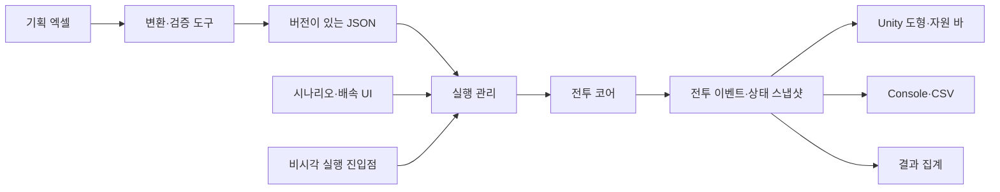

# Unity 전투 시뮬레이터 모듈 설계

> 2026-11-03 문서 정리: 본문은 작성 당시 조사·설계·제안·계획 기록이다. 현재 구현/검증 여부는 `07_현재구현_인수인계.md`, 실제 구조는 `06_구조_도식.md`에서 확인한다. 이후 변경을 자동으로 미구현 또는 전체 완료로 해석하지 않는다.


> 문서 갱신 규칙: 수정 전에 `Unity_Plan/backup/변경일시_설명/`을 만들고 수정 대상 원본을 복사·검증한 뒤 현재 문서를 갱신한다. 백업은 덮어쓰지 않는다. 이번 갱신 전 원본 4개는 `backup/before_rules_confirm_20261031_234048/`에 보관했다.
> 이번 갱신: 자원 선검사, 상태이상 감소/발동, 캔슬·차지, 중단 시 콤보 초기화, 타격별 모션밸류를 사용자 답변에 따라 확정했다. 최초 조사 통계는 당시 스냅샷이며 사용자 확정 규칙이 이전 기획·주석보다 우선한다.

작성일: 2026-10-31. 아래는 신규 설계 제안이며 현재 구현 상태가 아니다.

## 1. 권장 구조

처음부터 많은 패키지를 만들기보다 **Core / Application / Infrastructure / UnityPresentation / Tests** 다섯 영역으로 시작한다. 전투 규칙은 순수 C#인 Core에 모으고, 내부 기능은 폴더와 작은 클래스로 구분한다. 기능마다 별도 실행 프로젝트를 만들 필요는 없다.



참조 방향: Core는 Unity와 파일 입출력을 모른다. Application은 Core를 호출한다. Infrastructure와 UnityPresentation은 Application/Core가 제공하는 계약을 구현한다. 부트스트랩이 구현체를 연결한다. Core에서 Debug.Log, Transform, Time, MonoBehaviour를 직접 사용하지 않는다.

## 2. 기능별 모듈

| 영역 / 기능 | 책임 | 주요 입력 → 출력 | 담당하지 않는 일 |
| --- | --- | --- | --- |
| DataImport | 엑셀 구조 해석, 단위 정규화, 참조 검증 | 지정 시트 → JSON·오류 보고서 | 매 프레임 엑셀 읽기 |
| DataCatalog | 읽기 전용 정의 조회 | JSON → 캐릭터·스킬·AI 사전 | 전투 중 HP 저장 |
| Scenario | 팀·개체·배치·시드·반복수 정의 | 설정 → BattleScenario | 캐릭터 시각 생성 |
| Stats | 초기 능력치 및 효과 보정 | 기본값·장비·효과 → 최종값 | HP 바 갱신 |
| BattleWorld | 개체·시간·전투 수명 관리 | Scenario → BattleState | 파일 저장 |
| AI | 타겟·페이즈·조건·행동 선택 | 읽기 전용 상태 → ActionCommand | 피해 직접 적용 |
| Actions / Moveset | 행동 가능 여부, 콤보, 선딜·타격·후딜 | 명령·스킬 정의 → 실행 중 행동 | 의사결정 확률 선택 |
| Spatial | 이동·방향·거리·판정 후보 | 위치·범위 → 이동 결과·적중 후보 | Transform을 읽어 전투에 반영 |
| Combat | 가드·무적·패리·HP·강인도 계산 | 적중 후보·스탯 → 전투 결과 | 시각 효과 |
| StatusEffects | 상태 누적, 면역, 지속 피해, 버프 만료 | 효과 명령 → 상태 변화 | UI 타이머 |
| Resources | HP/FP/스태미나 비용과 회복 | 비용·시간 → 자원 변화 | 비용값 임의 보정 |
| SimulationRunner | tick 진행·일시정지·반복·취소 | 실행 설정 → 진행 상태 | 전투 공식을 복제 |
| Telemetry | 이벤트 구독·Console·CSV 기록 | 이벤트 → 로그 파일 | 로그로 전투 상태 역산 |
| Analytics | 승패·시간·DPS 등 집계 | 이벤트·최종 상태 → 결과 | 승패 규칙 별도 계산 |
| Presentation | 도형·회전·자원 바·판정 표시 | 스냅샷·이벤트 → 화면 | 적중 판정 확정 |
| UI | 선택·시작·정지·배속·내보내기 | 사용자 입력 → 실행 명령 | 코어 내부 수치 직접 수정 |

Core 내부 모듈은 작은 시스템으로 나누되 초기에는 순차 호출한다. ECS, 작업 시스템, 대규모 의존성 주입 프레임워크 도입은 실제 병목 측정 후 판단한다.

## 3. 데이터와 실행 상태 분리

| 객체 | 수명 / 주요 필드 |
| --- | --- |
| CharacterDefinition | 읽기 전용. DefinitionId, 이름 키, 스탯, MovesetId, AiProfileId |
| SkillDefinition | 읽기 전용. 비용, 타이밍, 타입, 범위, 모션 배율, 타격 구간, 효과 |
| AiDefinition | 읽기 전용. 행동표, 페이즈, 조건식, 전역 설정 |
| BattleScenario | 팀별 DefinitionId·수량·스폰 위치, seed, 제한 tick, 규칙/데이터 버전 |
| CombatantState | 전투별 가변. EntityId, TeamId, 위치, 방향, 현재 자원, 행동, 효과, 쿨다운 |
| BattleState | tick, 개체 목록, 난수 상태, 종료 상태 |
| BattleEvent | 값으로 복사된 발생 사실. EventSequence, tick, actor/target ID, 타입, 변화량 |
| BattleResult | 승자, 종료 사유, 소요 tick, 생존자, 누적 피해, 메타데이터 |

같은 검사 3명을 배치하면 DefinitionId는 같지만 EntityId는 서로 달라야 한다. Definition을 수정해 현재 HP를 저장하면 반복 전투끼리 상태가 섞인다. Unity ScriptableObject는 표시 설정과 편집용 프리셋에 사용하고, 전투 실행 상태를 공유 자산에 저장하지 않는다.

## 4. 핵심 인터페이스

아래는 구현 계약의 예시다. 구체 DTO는 데이터 정규화 이후 확정한다.

```csharp
public interface IBattleSimulation
{
    bool IsFinished { get; }
    long Tick { get; }
    void Step(); // 항상 전투 시간 1/30초 진행
    BattleSnapshot GetSnapshot();
    BattleResult GetResult(); // 종료 후에만 호출
}

public interface IBattleEventSink
{
    void OnEvent(in BattleEvent battleEvent);
}

public interface IRandomSource
{
    double NextUnit(); // [0, 1)
}
```

- Step은 벽시계 시간이나 화면 배속을 받지 않는다. 실행기가 호출 횟수로 속도를 조절한다.
- 이벤트는 이미 계산된 결과다. 구독자 추가/제거가 난수 소비와 피해량에 영향을 주면 안 된다.
- 화면은 프레임당 한 번 필요한 스냅샷을 읽는다. 비시각 실행은 화면용 스냅샷 생성을 생략할 수 있다.
- CSV 기록 실패는 오류로 표시하고 정책에 따라 실행을 중단하거나 기록 실패 상태로 계속한다. 성공한 저장으로 표시하지 않는다.
- 결과 집계는 Console/CSV 필터와 무관하게 원본 이벤트를 받는다.

## 5. 한 tick의 실행 순서 제안

원본 엔진이 없으므로 아래 순서를 새 규칙 버전으로 명시하고 테스트한다.

1. 예정된 상태 만료·회복·지속 피해 처리, 사망자 확정.
2. AI 판단 tick이면 같은 시점의 읽기 전용 상태를 기준으로 행동 의도 수집.
3. 자원·쿨다운·상태 검사 후 명령 승인, 자원 차감, 행동 시작.
4. 기존/신규 행동의 이동·추적·타임라인 진행.
5. 활성 타격 구간에서 논리적 공간 판정, 타격 후보 수집.
6. 고정된 순서로 가드/패리/무적·피해·강인도·효과 계산.
7. 사망·행동 중단·승패 확정, 이벤트와 최종 상태 발행.

동일 tick의 동시 타격은 사용자 확인으로 **동시 교환을 확정**했다. 후보를 먼저 수집하고 해당 단계 시작 시 유효했던 공격을 모두 해결한다. 같은 tick에 치명타를 맞았다는 이유로 이미 성립한 반격을 취소하지 않는다. 사망 이벤트는 해결 단계 후 확정하며 동시 전멸이 가능하다. 후보 정렬은 공격자 EntityId→행동 인스턴스→타격 번호→대상 EntityId처럼 고정하고, 같은 대상에 같은 타격이 중복 적용되지 않게 한다.

빙결은 이동·공격·구르기의 속도/진행률에만 50%를 적용한다. 전역 tick, AI 판단 주기, 자원 회복, 쿨다운, 지속효과 시계는 유지한다. StatusEffects는 누적 직후부터 초당 5 감소, 중독 발동 1초 후 첫 피해, 상처 피해 직후 재누적을 처리한다. 만료 시각과 마지막 중독 피해가 겹치면 예정된 마지막 피해를 처리한 뒤 만료시키는 순서를 제안한다.

### 확정된 자원·타격 계약

- 플레이어 스태미나 소모 행동: 비용이 양수이면 현재 스태미나 1 이상일 때 승인. 전체 비용을 차감하고 음수를 보존한다. 1 미만인 동안 새 스태미나 소모 행동은 거절한다. 이미 승인된 행동은 자신의 비용 때문에 음수가 됐다는 이유로 취소하지 않는다.
- Resources가 실제 음수 값을 소유한다. Presentation만 바 채움량을 0으로 제한하며 숫자·CSV에는 실제 음수를 남긴다.
- 현재 플레이어 스킬의 스태미나 비용은 50이다. 캐릭터 최대 FP/스태미나를 50으로 덮어쓰지 않는다.
- 몬스터 FP/스태미나는 0을 유지한다는 사용자 지침을 따른다. 비용·가드·AI 자원 조건 처리와 데이터 예외는 구현계획의 확인 항목에 기록한다.
- Animation.Hit_Time과 Motion_Value는 쉼표 구분 목록을 같은 순서로 연결한다. 타격 번호별로 시점·모션밸류·적중 기록을 소유한다. Motion_Value[i]/100000을 해당 타격 배율로 적용하며 Hit_Count로 나누지 않는다. Hit_Count 및 두 목록 길이가 다르면 임의 분할/복제하지 않고 검증 오류를 낸다. 단일 타격은 기존 단일 값 표기를 허용한다.
- HP/FP는 차감 전 가상 잔여량을 검사한다. HP는 1 이상, FP는 0 이상 남아야 가능하며 조건 미달이면 모든 비용을 차감하지 않는다. AI가 가능한 행동을 고르기 전에 이 검사와 스태미나 조건을 적용한다. 실행 직전 상태가 변했으면 다시 검사한다.
- Cancel_Time=0은 현재 동작을 끝까지 수행한다. 기절·경직 등 강제 중단을 막는 슈퍼아머를 뜻하지 않는다. 강제 중단 시 다음 콤보로 이어가지 않고 이전 노드·연계 예약을 초기화한다.
- 차지 가능 여부와 실제 충전시간을 분리한다. 지원 스킬의 충전시간 0은 기본 배율 공격이다. 플레이어 방어 동작의 Cancel_Time=0은 임시 데이터로 표시하고 임의의 교정값을 넣지 않는다.

## 6. AI 모듈의 구체 분리

- TargetSelector: 최근접 및 20% 히스테리시스. 정확한 전환식은 `새 거리 < 기존 거리 × 0.8`을 제안값으로 둔다.
- PhaseResolver: HP 구간을 검사하고 페이즈 전환 이벤트를 한 번 발행. 50%처럼 경계가 겹치는 경우 우선순위 지정.
- ConditionEvaluator: 허용 변수·비교·AND·최근 행동 함수만 해석. 임의 코드 실행 방식은 사용하지 않는다.
- BehaviorSelector: 자원 등 사용 가능 조건을 먼저 검사해 실행 불가 행동을 제외한 뒤, Eval_Order·조건·쿨다운·확률에 따라 선택한다. 스태미나가 0 또는 음수일 때 스태미나 비용이 필요한 행동은 후보에 넣지 않는다. 이전 확정된 재개 기준 1 이상을 유지한다. 자원 부족 행동을 일단 골라 실패 모션을 내는 흐름은 사용하지 않는다. 사용 가능한 행이 없으면 대기하는 폴백을 둔다.
- MovesetResolver: GroupIndex·Prev_Node_ID·Input_Slot에서 다음 노드를 찾아 Skill_Id 반환. 유효하지 않은 연계는 정해진 루트 노드로 초기화.
- ActionExecutor: 선택된 결과를 승인/거절하고 실행. AI에서 실제 HP를 변경하지 않는다.

몬스터 이름을 런타임마다 파싱하는 기존 연결은 변환 단계에서 해결한다. 정규화 JSON에는 확정된 AiProfileId를 넣고 원본 ID는 추적 정보로 남긴다.

## 7. 모듈 교체와 검증 경계

| 교체 요구 | 바뀌는 영역 | 유지되어야 할 것 |
| --- | --- | --- |
| 캡슐을 실제 모델로 변경 | Presentation 프리팹·모션 어댑터 | 같은 전투 이벤트와 결과 |
| CSV 대신 다른 저장 방식 | Telemetry의 Sink | 코어 계산과 이벤트 순서 |
| AI 성향 추가 | AI 정의·조건/행동 지원 | 스킬 실행·피해 공식 |
| 비시각 실행 | Runner와 부트스트랩 | 동일 Step·난수·종료 규칙 |
| 장비 UI 도입 | Stats·Scenario 편집 | 기존 최종 스탯 입력 경로 |
| 장애물/높이 추가 | Spatial과 시나리오 스키마 | 화면만 장애물을 적용하지 않기 |

처음에는 결정성 검증을 같은 빌드·같은 플랫폼 내에서 보장한다. 서로 다른 CPU/런타임까지 완전 일치를 요구하게 되면 고정소수점, 수학 함수, 난수 알고리즘을 추가로 표준화한다.
