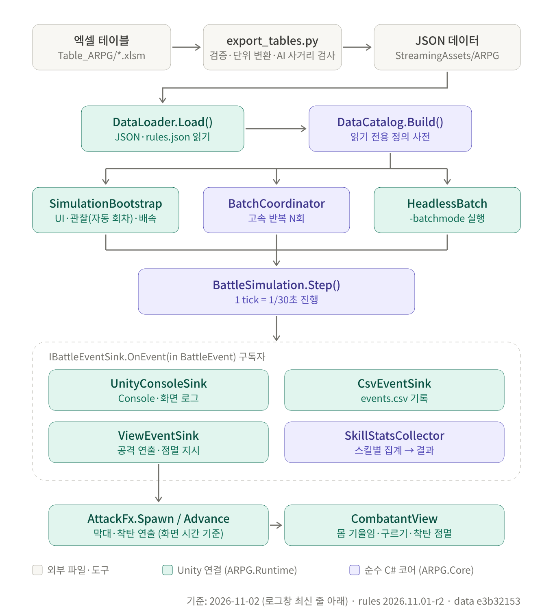
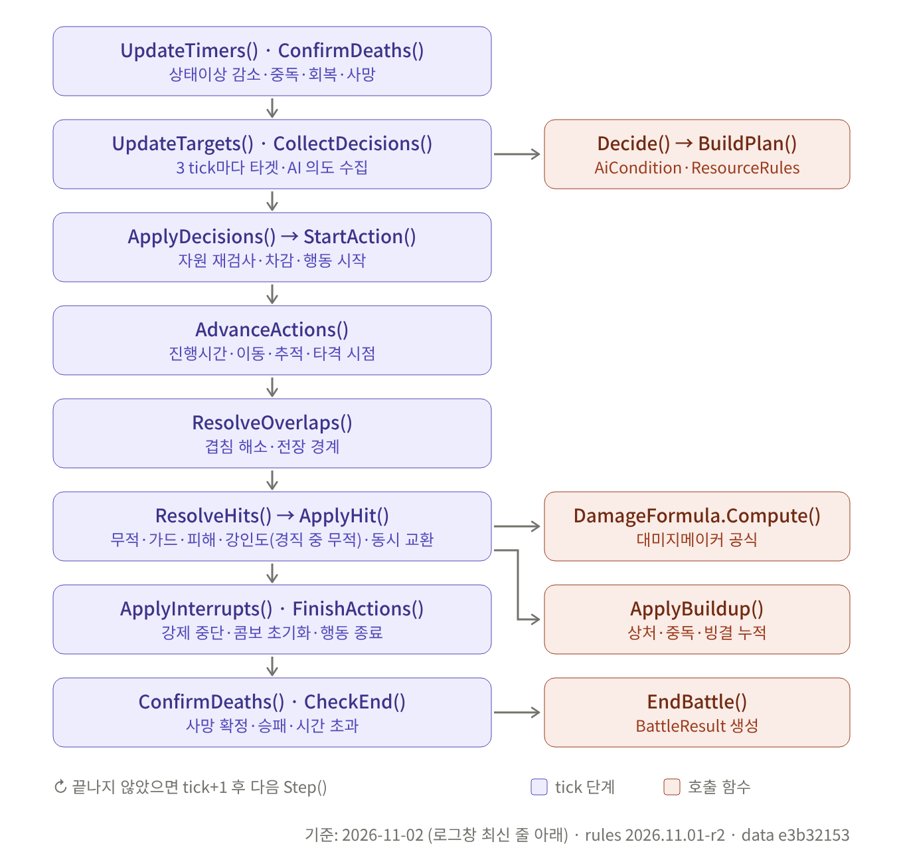

# 프로그램 구조 도식

> **갱신 규칙**: 프로그램(코드·데이터 구조·규칙)에 변경이 생길 때마다 이 문서와 `diagrams/` 의 도식(SVG·PNG)을 다시 저장한다.
> - 클래스·함수·호출 관계·실행 순서·데이터 흐름이 바뀌면 도식 내용을 고친다.
> - 구조 변화가 없는 변경(수치·데이터만 변경)이어도 도식 하단의 기준 표기(날짜·rules 버전·dataHash)와 아래 변경 이력을 갱신한다.
> - 갱신 전에 기존 문서 갱신 규칙대로 `Unity_Plan/backup/변경일시_설명/` 에 이 문서와 `diagrams/` 폴더를 복사해 둔다. 백업은 덮어쓰지 않는다.
> - 도식 원본은 `diagrams/_src/src_01.svg`, `src_02.svg` 이고, `python diagrams/_src/build_diagrams.py diagrams/_src diagrams "기준: 날짜 · rules 버전 · data 해시"` 로 SVG·PNG 를 다시 만든다(Playwright 필요).

현재 기준: 2026-11-02 (로그창 최신 줄 아래) · rules `2026.11.01-r2` · dataHash `e3b32153437ff369`

## 1. 전체 구조



| 구분 | 클래스·함수 | 역할 | 연결 |
| --- | --- | --- | --- |
| 데이터 변환 | `Tools/ExcelExport/export_tables.py` (`export`, `read_moveset`, `read_chars`, `check_ai_skill_reach`, `write_report`) | 엑셀 시트를 읽어 검증·단위 변환 후 JSON 출력. AI 거리 조건과 무브셋 스킬 도달 거리가 맞지 않으면 `[AI·스킬 불일치]` 경고(`load_rules`, `dist_interval`, `skill_reach`, rules.json 거리 기준 사용) | Table_ARPG → StreamingAssets/ARPG/Data, validation_report.md |
| 로드 | `DataLoader.Load()`, `LoadRules()`, `ScenarioStore.Load/Save()` | JSON·rules.json·시나리오 읽기 | → `DataCatalog.Build()` |
| 정의 사전 | `DataCatalog.Build()`, `ResolveMoveset()`, `SortRules()` | 캐릭터·스킬·무브셋·AI 를 읽기 전용으로 보관 | 모든 실행기와 `BattleSimulation` 이 공유 |
| 관찰 실행 | `SimulationBootstrap` (`PrepareObserve`, `Update`, `UpdateViews`, `OnGUI`), `VisualSimulationRunner.Update()` | 화면·배속·UI, 프레임마다 쌓인 시간만큼 `Step()` 호출 | → `BattleSimulation.Step()`, `CombatantView.Apply()` |
| 자동 다음 회차 | `SetAutoNext()`, `UpdateAutoNext()`, `CountAutoResult()`, `PrepareObserve(index, keepCamera)` | 관찰 모드에서 판 종료 → 1.2초/배속 대기 → 다음 회차 자동 재생, 회차가 시나리오 `runs` 에 닿으면 정지. 누적 승패 표시, 카메라·추적 대상 유지 | `Update()` 에서 `OnObserveFinished()` 다음 호출, UI 토글 '자동 다음 회차' |
| UI 글자 배율 | `EnsureStyles()`, `ApplyUiScaleToStyles()`, `RequestUiScaleStep()`, `W()`/`S()`, `DrawUiScaleControl()` | 전용 GUISkin 복사본의 글꼴 크기·고정 높이와 패널 폭·고정 폭을 80~200% 로 조절. 변경은 다음 Layout 단계에서 반영, PlayerPrefs `ARPG.UiScale` 저장 | 왼쪽 패널 `글자 - % +` 버튼, `HandlePointer()` 의 Ctrl +/- |
| 고속 반복 | `BatchCoordinator.Run()`, `BatchSummary.Add()` | 화면 없이 N회 실행·집계 | `SimulationBootstrap.StartBatch()`, `HeadlessBatch.Execute()` 가 사용 |
| 명령줄 실행 | `HeadlessBatch.Execute()` | `-batchmode -arpgBatch` 인자 처리 | → `BatchCoordinator` |
| 전투 코어 | `BattleSimulation.Step()` | 1 tick(1/30초) 진행, 이벤트 발행 | → `IBattleEventSink.OnEvent()` |
| 이벤트 구독자 | `UnityConsoleSink`, `CsvEventSink`, `ViewEventSink`, `SkillStatsCollector`, `EventHashSink` | Console·CSV 기록, 공격 연출·점멸 지시, 스킬 집계, 결정성 해시 | 결과: `ResultsCsvWriter`, `SummaryExporter` / `ViewEventSink` → `AttackFx.Spawn()` |
| 공격 연출(화면 전용) | `AttackFx.Spawn()`, `Advance()`, `AdvanceBy()`, `Clear()` | HitResolved·Guarded·HitAvoided·MISS 이벤트로 공격자 → 대상 막대와 착탄 구체 표시. 시계는 표시 중인 전투 시간(`Tick - 2 + alpha`)이라 정지·배속·1 tick 을 따름. 착탄 시 대상 점멸 | `ViewEventSink` 가 생성, `SimulationBootstrap.UpdateAttackFx()` 가 진행, → `CombatantView.FlashHit()/FlashGuard()` |
| 개체 표시 | `CombatantView.Apply()`, `DisplayElapsed()`, `AttackPose()`, `ApplyRoll()`, `GroundedCenterHeight()`, `FlashHit()`, `FlashGuard()` | 위치 보간, 행동 진행 시간 보간(직전 tick→현재 tick), 몸 기울임(공격: 선딜 −8° → 타격 +22°·0.18m 내딛기 → 후딜 복귀, 경직·기절·사망), 구르기(X축 360° 앞/뒤 구르기, 바닥 접지 높이, 웅크림, 무기 숨김), 무기 휘두르기, 색 상태 | `SimulationBootstrap.UpdateViews()` 가 호출 |

## 2. `BattleSimulation.Step()` 1 tick 실행 순서



| 순서 | 함수 | 역할 | 호출하는 함수 |
| --- | --- | --- | --- |
| 1 | `UpdateTimers()`, `ConfirmDeaths()` | 상태이상 게이지 감소, 중독 피해, 빙결·기절·경직 해제, 강인도·스태미나 회복, 사망 확정 | — |
| 2 | `UpdateTargets()`, `CollectDecisions()` | 3 tick 마다 타겟 갱신과 AI 의도 수집 | `UpdatePhase()`, `Decide()` → `BuildPlan()` (`AiCondition.Evaluate`, `ResourceRules.Check`, `ResolveMoveset`) |
| 3 | `ApplyDecisions()` → `StartAction()` | 자원 재검사, 비용 차감, 행동 시작, 쿨다운·콤보 기록 | `EndAction()` (캔슬 연결 시) |
| 4 | `AdvanceActions()` | 행동 진행 시간 누적, 이동·추적, 타격 시점 도달 수집 | `MoveSoft()`, `AdvanceSkill()` |
| 5 | `ResolveOverlaps()` | 개체 겹침 해소, 전장 경계 | — |
| 6 | `ResolveHits()` → `ApplyHit()` | 같은 tick 타격 동시 해결: 무적, 가드, 피해, 강인도(경직 중이면 강인도 무적 — HP 만 감소, `poiseImmuneWhileStaggered`) | `GatherTargets()`, `DamageFormula.Compute()`, `ApplyBuildup()` |
| 7 | `ApplyInterrupts()`, `FinishActions()` | 경직·기절 행동 강제 중단과 콤보 초기화, 끝난 행동 종료 | `EndAction()` |
| 8 | `ConfirmDeaths()`, `CheckEnd()` | 사망 확정, 승패·동시 전멸·시간 초과 판정 | `EndBattle()` → `BattleResult` |

각 단계에서 생긴 사건은 `NewEvent()` → `Emit()` 으로 구독자에게 전달된다. 구독자는 기록만 하며 전투 결과를 바꾸지 않는다.

## 3. Unity 프레임 루프(관찰 모드)

```
SimulationBootstrap.Update()
  ├─ VisualSimulationRunner.Update(unscaledDeltaTime)  → BattleSimulation.Step() × N
  │    판 종료 시 OnObserveFinished() → (자동 다음 회차) UpdateAutoNext() → PrepareObserve(next, keepCamera:true)
  ├─ HandlePointer()   마우스 선택, 단축키(Space, ., F, Ctrl +/- 글자 배율 요청)
  └─ UpdateViews()     CombatantView.Apply()(DisplayElapsed → 몸 기울임·구르기·무기) / ResourceBarsView.Apply()
                      / UpdateAttackFx() → AttackFx.Advance(Tick-2+alpha) (종료 후 AdvanceBy) / DebugDraw
  (Step 중 발생한 이벤트 → ViewEventSink.OnEvent() → AttackFx.Spawn(), 꺼져 있으면 즉시 점멸)
SimulationBootstrap.OnGUI()
  ├─ EnsureStyles()    전용 GUISkin, 배율 요청을 Layout 단계에서 반영 → ApplyUiScaleToStyles()
  └─ DrawTopBar() / DrawLeftPanel() / DrawRightPanel() / DrawLogPanel()(오래된 줄 위·최신 아래, 맨 아래 따라가기) / DrawPicker()
CameraRig.LateUpdate()  카메라 회전·확대·이동
```

## 변경 이력

| 날짜 | 내용 |
| --- | --- |
| 2026-11-01 | 최초 작성(1차 구현 기준: Core/Runtime/Editor, 변환기 1.0.0) |
| 2026-11-01 | 공격 연출 추가: `AttackFx`(막대·착탄, UI 토글 '공격 이펙트'), `CombatantView.AttackPose()`(몸 기울임·내딛기), `ViewEventSink` 가 HitAvoided·MISS 도 처리. 코어·판정 변화 없음. 백업 `backup/20261101_150213_attack_fx/` |
| 2026-11-01 | UI 글자 배율 추가: 왼쪽 패널 `글자 - % +`·Ctrl +/- (80~200%), 기본 GUISkin 대신 전용 복사본 사용, 고정 폭 `W()`·사각형 `S()` 배율 적용, 캐릭터 선택 창 제목을 내용 첫 줄로 이동. 코어 변화 없음. 백업 `backup/20261101_152431_ui_scale/` |
| 2026-11-01 | 관찰 모드 자동 다음 회차(`SetAutoNext`/`UpdateAutoNext`, `PrepareObserve(index, keepCamera)`), 구르기 X축 360° 연출(`ApplyRoll`, `GroundedCenterHeight`), 행동 진행 시간 화면 보간(`DisplayElapsed`), 사용 설명서 `Manual/ARPG_전투시뮬레이터_사용설명서.html` 추가. 코어 변화 없음. 백업 `backup/20261101_154312_auto_next_roll/` |
| 2026-11-01 | 변환기 1.1.0: `check_ai_skill_reach()` 추가 — AI_BEHAVIOR 거리 조건(dist/dist_m)과 캐릭터 무브셋 스킬의 도달 거리(BuildPlan 과 같은 계산)를 비교해 항상/대부분 사거리 밖, 슬롯 없음, 스킬 비활성을 경고. `--rules` 인자. Unity 코드 변화 없음. 백업 `backup/20261101_161237_ai_skill_check/` |
| 2026-11-01 | `Core/Combat/CombatFormulas.cs` 의 `DamageFormula` 함수·줄 단위 주석 추가(계산 코드는 그대로, 주석 제거 후 비교로 동일 확인). 구조 변화 없음. 백업 `backup/20261101_191919_formula_comments/` |
| 2026-11-02 | 경직 중 강인도 무적: `ApplyHit()` 에서 대상이 경직 중이면 강인도 감소·재경직 없이 HP 피해만 적용(경직 시작 때 강인도 최대치로 채움). rules `poiseImmuneWhileStaggered`(기본 true), rulesVersion `2026.11.01-r2`, Self Test `TestStaggerPoiseImmunity` 추가. 새 PC 프로젝트 경로 `E:\6.GIT\BS\BATTLE_SIMUL` 기준, dataHash `e3b32153437ff369`(사용자 재변환). 백업 `backup/20261102_000514_stagger_poise_immunity/` |
| 2026-11-02 | 화면 로그창 순서 반대로: 오래된 줄이 위, 최신 줄이 아래(최근 60줄). 맨 아래를 보고 있으면 새 줄을 따라 내려가고 위로 올려 읽는 중이면 멈춤, 그때 '▼ 최신으로' 버튼 표시. `UnityConsoleSink.Version`(새 줄 감지) 추가. 코어 변화 없음. 백업 `backup/20261102_001342_log_bottom_newest/` |
